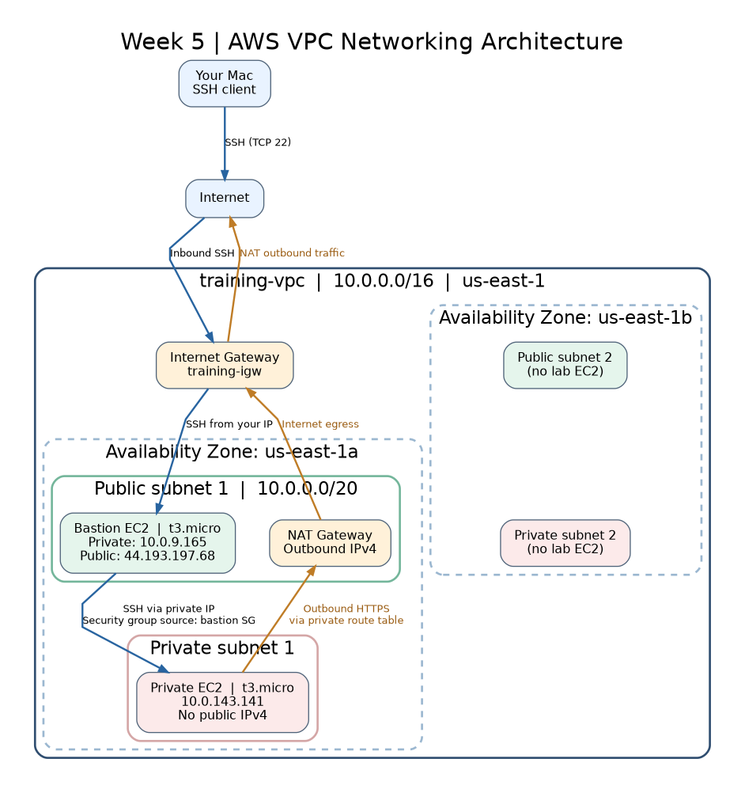

# Week 5 — AWS VPC Networking Deep Dive

## Overview

This lab demonstrates how to build and configure a custom Amazon VPC with public and private subnets, secure access through a bastion host, and outbound internet connectivity through a NAT Gateway.

The objective was to understand AWS networking fundamentals, implement secure EC2 connectivity, and troubleshoot common networking issues.

## Architecture



### AWS Resources

| Resource           | Configuration               |
| ------------------ | --------------------------- |
| AWS Region         | us-east-1 (N. Virginia)     |
| VPC                | training-vpc                |
| VPC CIDR           | 10.0.0.0/16                 |
| Availability Zones | us-east-1a, us-east-1b      |
| Public Subnets     | 2                           |
| Private Subnets    | 2                           |
| Internet Gateway   | 1                           |
| NAT Gateway        | 1                           |
| Bastion Host       | Amazon Linux 2023, t3.micro |
| Private EC2        | Amazon Linux 2023, t3.micro |

## Lab 5.1 — Custom VPC Configuration

Created a custom VPC using the AWS Management Console with the following networking components:

- **VPC:** Provides an isolated virtual network within AWS.
- **Public Subnets:** Host resources requiring direct internet connectivity.
- **Private Subnets:** Host resources without direct inbound internet access.
- **Internet Gateway:** Enables communication between public resources and the internet.
- **NAT Gateway:** Allows private instances to initiate outbound internet connections.
- **Route Tables:** Determine where network traffic is directed.

### Routing Configuration

**Public subnet route table**

| Destination | Target           |
| ----------- | ---------------- |
| 10.0.0.0/16 | Local            |
| 0.0.0.0/0   | Internet Gateway |

**Private subnet route table**

| Destination | Target      |
| ----------- | ----------- |
| 10.0.0.0/16 | Local       |
| 0.0.0.0/0   | NAT Gateway |

The public subnets were associated with the public route table, while the private subnets used route tables providing outbound connectivity through the NAT Gateway.

## Lab 5.2 — Bastion Host Pattern

### Objective

Securely connect to an EC2 instance in a private subnet without assigning it a public IP address.

### Implementation

1. Launched a bastion host in a public subnet.
2. Enabled public IPv4 addressing for the bastion.
3. Configured the bastion security group to allow SSH (TCP 22) from my IP address.
4. Launched a second EC2 instance in a private subnet.
5. Configured its security group to allow SSH only from the bastion security group.
6. Used SSH agent forwarding to connect through the bastion.

### SSH Commands

Start the SSH agent on the local machine:

```bash
eval "$(ssh-agent -s)"
```

Load the SSH private key:

```bash
ssh-add ~/.ssh/training-key.pem
```

Connect to the bastion host:

```bash
ssh -A -i ~/.ssh/training-key.pem ec2-user@44.193.197.68
```

From the bastion, connect to the private EC2 instance:

```bash
ssh ec2-user@10.0.143.141
```

### Result

Successfully connected to the private EC2 instance through the bastion host using SSH agent forwarding.

The private instance had no public IPv4 address, and its SSH security group rule allowed access only from the bastion security group.

**Security benefit:** SSH agent forwarding allowed authentication without copying the private SSH key onto the bastion host.

## Lab 5.3 — Private Instance Internet Connectivity

### Objective

Verify that an EC2 instance in a private subnet could access the internet through the NAT Gateway.

### Connectivity Test

After connecting to the private instance, executed:

```bash
curl -I --connect-timeout 5 --max-time 15 https://aws.amazon.com
```

### Result

```text
HTTP/2 200
content-type: text/html;charset=utf-8
```

The successful HTTP response confirmed that the private instance could establish an outbound HTTPS connection.

### Traffic Flow

1. The private EC2 instance initiated an outbound HTTPS request.
2. The private subnet route table directed internet-bound traffic to the NAT Gateway.
3. The NAT Gateway forwarded traffic through the Internet Gateway.
4. The external website returned a response through the established connection.

The private instance remained inaccessible directly from the public internet.

## Troubleshooting Knowledge

A common networking issue is a private EC2 instance being unable to access the internet even when a NAT Gateway exists.

Important troubleshooting checks include:

- Verify that the NAT Gateway is available.
- Confirm that the private route table contains a default route to the NAT Gateway.
- Confirm that the private subnet is associated with the correct route table.
- Check security group outbound rules and network ACLs.
- Confirm that the public subnet has a route to the Internet Gateway.

The key lesson is that creating a route table does not automatically associate it with the intended subnet.

## Resource Cleanup

After completing the labs, removed the temporary AWS resources to avoid unnecessary charges.

- Terminated the bastion EC2 instance.
- Terminated the private EC2 instance.
- Deleted the NAT Gateway.
- Released its Elastic IP address.
- Deleted the training VPC and its associated networking resources.

## Key Takeaways

- Designed a custom AWS VPC spanning two Availability Zones.
- Configured public and private subnets with appropriate routing.
- Implemented secure administrative access using a bastion host.
- Used security group references to restrict private EC2 SSH access.
- Practiced SSH agent forwarding to avoid storing private keys on intermediary hosts.
- Verified outbound HTTPS connectivity from a private instance through a NAT Gateway.
- Learned how route table associations affect subnet connectivity.
- Practiced AWS resource cleanup and cost management.

## Technologies Used

**AWS VPC · Amazon EC2 · Public/Private Subnets · Route Tables · Internet Gateway · NAT Gateway · Elastic IP · Security Groups · SSH · Amazon Linux 2023**
